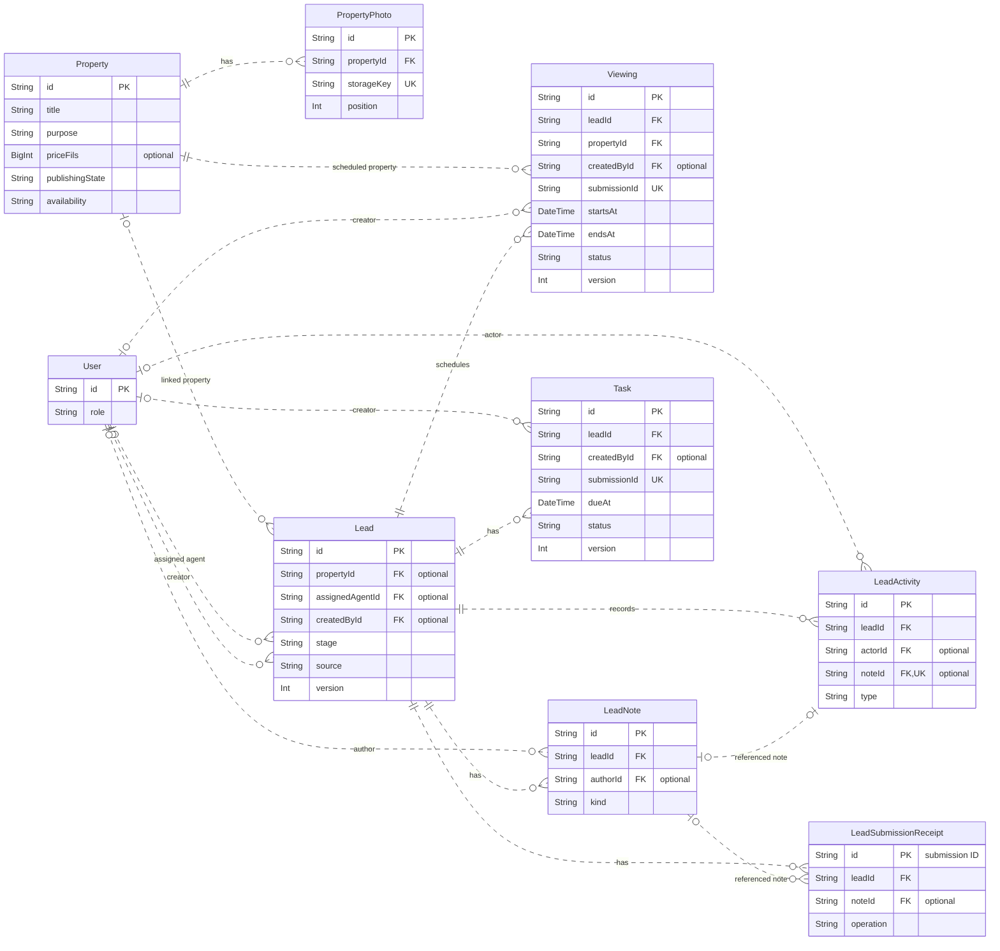
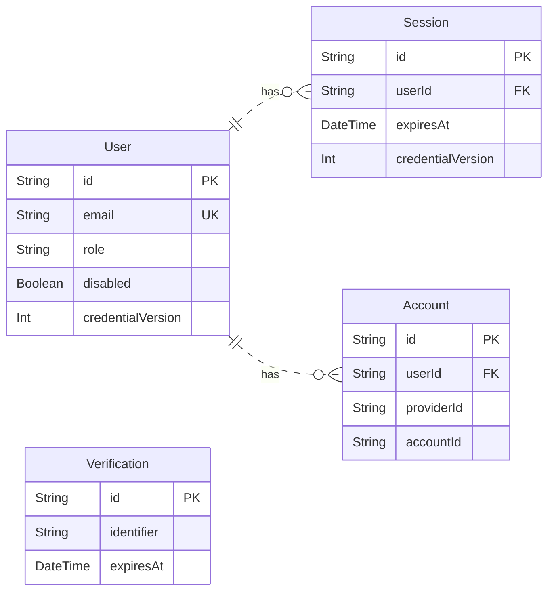

# Avenor Properties data model

These entity-relationship diagrams describe the SQLite models in the [Prisma schema](../prisma/schema.prisma). They show every model and foreign-key relationship, with selected columns for quick scanning. The schema defines the full column list, defaults, indexes and constraints.

## Properties and CRM

- **Lead** links an inquiry or sales opportunity to an optional property and optional staff assignee. An unassigned lead can still have activity and notes.
- **Viewing** requires both a lead and a property. **Task** requires a lead. Staff access to both follows the lead's current assignment.
- **Photo** rows contain metadata and a storage key. The image files live on disk. A property with viewing history is protected by the viewing foreign key.
- **Submission receipts** let the leads service recognize retries. Viewings and tasks record their own submission IDs on their rows.

## Staff authentication

`User` is the same staff model shown in the CRM diagram. Each session and account references one user and is deleted if that user is deleted. `Account` has a composite unique constraint on `providerId` and `accountId`. `Verification` has no foreign-key relationship in the Prisma schema.

The chatbot reads live properties from SQLite and retrieves FAQs from a separate local JSON index. See the [chatbot spec](../specs/public-property-chatbot/spec.md#software-design-at-a-glance) for that retrieval flow.
