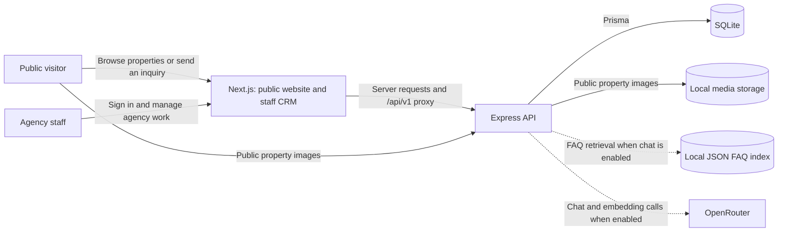
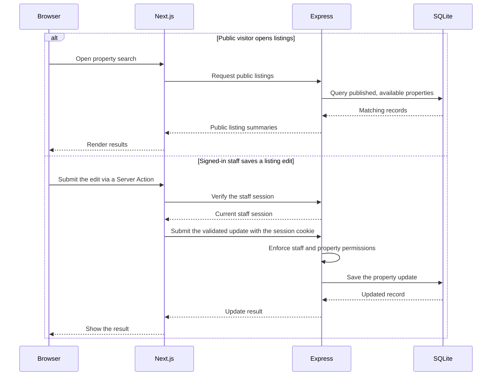

# Avenor Properties system design

Avenor serves property seekers through a public website and agency staff through a CRM. Both surfaces run in one Next.js application. A separate Express application owns the API, business rules, permissions and persistence.

## System at a glance

| Area                      | Responsibility                                                                                                                                                                         |
| ------------------------- | -------------------------------------------------------------------------------------------------------------------------------------------------------------------------------------- |
| **Next.js**               | Renders public property discovery, listing details and inquiries. Staff use the same app for inventory, leads, pipeline, viewings, tasks and dashboard.                                |
| **Express**               | Owns the HTTP contracts, Better Auth sessions, staff permissions, public listing rules, inquiry handling, CRM workflows and optional property chat.                                    |
| **SQLite and local disk** | SQLite stores staff and session records, properties, photo metadata, leads, viewings and tasks. Local disk holds property image files.                                                 |
| **Optional chatbot**      | Uses OpenRouter to classify questions. Listing searches query live public inventory in SQLite. FAQ answers use a local JSON vector index and the configured chat and embedding models. |

## How requests cross the system

- **Sign-in and sign-out** use the native Better Auth endpoints through Next.js's same-origin `/api/v1` proxy. Express verifies the current session and authorizes each protected operation.
- **Public inquiries** pass through Next.js to Express, where trusted client identity and rate limits are checked before an accepted submission creates a lead.
- **Public images** use backend-provided URLs under `/media/:key`. Public inquiry and CRM data stay behind their respective API rules.

## Runtime and deployment

- **Local development** runs Next.js on port 3100 and Express on port 4311. Each app has its own configuration. Next.js uses the server-only `API_URL` to reach Express.
- **Production requirements** include coordinated HTTPS origins, trusted ingress for anonymous submissions, and persistent storage and backups for SQLite and property media. In-process rate limits and chatbot quotas need a shared-state decision before scaling to multiple instances.
- **Chat rollout** is opt-in. The enabled backend requires a valid FAQ index and server-only provider credentials. The production deployment remains tracked in the roadmap.

## Go deeper

- [Repository architecture](../architecture.md) for code boundaries and implementation details.
- [Feature specifications](../../specs/README.md) for behavior, permissions and contracts.
- [Tech stack](../../TECH_STACK.md) for active and deferred tools.
- [Development guide](../development.md) for setup and operational checks.
- [Roadmap](../../ROADMAP.md) for delivery and deployment status.
