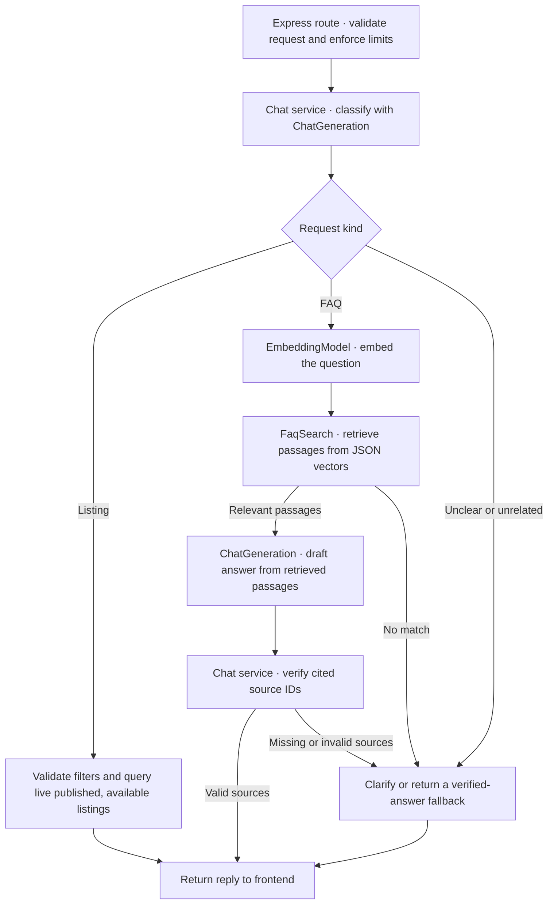

# Public property chatbot

Status: Verified opt-in demo for Phase 2 (P2-08). Real-business publication remains gated.

## Goal

Ground public chat replies in published agency FAQs or current public listings and let visitors continue through the existing inquiry flow.

## Scope and exclusions

- In scope: bounded public chat, semantic FAQ retrieval, live listing filters, and independent replacement of chat generation, embeddings and vector retrieval.
- Out of scope: CRM data access, chat persistence, bookings, lead writes, and a separate vector database for the first release.

## Behavior and contracts

Express owns the [public chat API contract](contract.md). One chat model call classifies the request and, for listing searches, proposes typed filters. Validate the result against the public listing constraints and use the existing property service to read published, available records. Return at most three public summaries. The first version uses the existing `minBedrooms` semantics for “at least” requests. When the visitor explicitly asks for an exact count, apply exact matching in the public query before limiting results. Clarify an unspecified rent period before applying a budget. Store and compare prices in AED fils with the existing bounds.

For FAQs, index approved plain text with stable source IDs, link metadata and vectors. Generate the index on demand during content preparation. At request time embed the question, rank stored vectors by cosine similarity and retrieve up to three passages. Use a relevance threshold established against the demo FAQ fixture. Give the chat model only the matching text and the question. Verify any cited source IDs against the retrieved set. If evidence is missing or a cited source cannot be validated, offer Contact. Treat FAQ text and visitor text as data.

Use OpenRouter with `nvidia/nemotron-3-embed-1b:free` for embeddings and `nvidia/nemotron-3.5-lightning:free` for chat as the defaults. Express uses a server-only `OPENROUTER_API_KEY` for `/api/v1/embeddings` and `/api/v1/chat/completions`. Keep model IDs independently configurable. Use three small backend interfaces for generation, embedding and FAQ retrieval. Load the versioned JSON index into memory and validate its embedding identity and dimensions before serving requests. The calibrated JSON similarity cutoff is 0.20. Changing the embedding model or its vector configuration requires reindexing before switching. A compatible vector store can import the existing vectors, source IDs and text with equivalent similarity scoring. Changing the chat model requires a behavior check.

Use an explicit enable flag, request validation, per-client and shared upstream request limits, a provider timeout, and safe errors. The defaults are five requests per client per minute and 45 provider calls in each rolling 24-hour period per application instance. Apply the aggregate limit to each upstream call so multi-call turns respect the configured allowance. Send bounded public context and visitor questions to the provider. Exclude CRM, owner and inquiry records from retrieval and avoid logging message bodies, provider payloads or credentials.

## Software design at a glance

- **Routing and validation.** The [HTTP route](../../src/modules/public-chat/public-chat.routes.ts) applies request guards. The [chat service](../../src/modules/public-chat/public-chat.service.ts) validates model output and chooses the FAQ, listing or fallback path. The [property service](../../src/modules/properties/properties.service.ts) owns the live inventory query.
- **Model replacement.** [Runtime wiring](../../src/modules/public-chat/public-chat.runtime.ts) passes the configured chat and embedding models through the [OpenRouter adapter](../../src/modules/public-chat/public-chat.providers.ts). Changing the embedding model requires rebuilding the FAQ index with that model.
- **Vector store replacement.** The [FAQ search module](../../src/modules/public-chat/public-chat.faq.ts) implements `FaqSearch` using the JSON index. Wire another implementation into the runtime to change retrieval storage while preserving the passage and source contract.

## Acceptance criteria

- [x] FAQ paraphrases retrieve the expected sources. Unanswerable and weak matches offer Contact.
- [x] Listing results reflect live visibility and correct budget units. Unknown or invalid model filters cannot expand the query.
- [x] Disabled mode, malformed input, throttling, timeouts and invalid provider outputs return safe errors without leaking data.
- [x] Generation, embedding and search can be substituted independently in tests. An incompatible FAQ index prevents chat from serving.
- [x] The backend contract and frontend API snapshot agree. Chat performs zero writes to CRM or inquiry data.

## Validation

The deterministic provider, FAQ fixture and disposable SQLite listing data cover exact bedrooms before limiting, annual price bounds, stale listing visibility, malformed provider output, source validation, quotas and index compatibility. A bounded live smoke using synthetic messages indexed five 2048-dimensional FAQ vectors and returned a sourced answer plus an eligible two-bedroom listing with the configured NVIDIA pair. `google/gemma-4-26b-a4b-it:free` was not retained because it repeatedly returned HTTP 429 during this smoke.

## Risks and rollout

Free model availability and quotas may change. Confirm the model IDs and usable limits during implementation. Disable the feature to roll back. Approve the FAQ text and visitor privacy wording before real-business publication. A vector database or another provider can be introduced later through the same feature interfaces.
